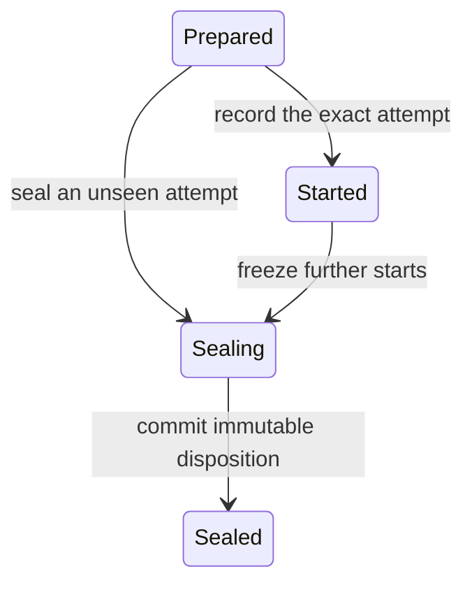

# Remote authority state foundation

This foundation selects a new version-1 operational custody assignment. It adds
an intrinsic remote-execution hold to the reference authority history and a
separate monotone worker journal. It does not start a network endpoint or grant
execution from a signed file. The ordinary version-0 assignment, command and
entry encodings remain unchanged.

## Failure being addressed

A same-process mutex protects a local effect only until its owner process dies.
If A sent work to B and then died, B might still run or receive a delayed Start.
Reopening A and accepting Complete, Stop or Retire without retaining that fact
would lose the live exclusion boundary. A disconnected peer, an expired timer,
a signed historical admission and an empty current handler count are each
insufficient evidence that B can no longer execute.

The threat model assumes conforming binaries, protected original state and
exclusive key ownership. A malicious key holder, copied roots, privileged
rollback/deletion and physical media failure still require independent fencing.
Two paths on one filesystem do not supply that protection.

## Explicit version selection

Version 1 commits separate remote control and transport public keys in the
assignment. They must be distinct from each other and from every authority,
consumer, auditor and replica evidence key. The replica receipt/proof identity
is retained: moving its private key to A is not part of this design.

`custodyauthority.WithRemoteParticipant` and the archive-facing
`workarchive.CreateRemoteCustodyAuthorityAssignment` select a fresh assignment
with a different independently retained ID. They create no owner, migrate no
used history and activate no worker. There is no implicit upgrade of a used
version-0 root. Older decoders reject the version-1 assignment even at sequence
zero. The new entry decoder rejects mismatched entry/command versions, while
State validation and replay also require the independently pinned assignment
version to match.

Version-1 signatures and IDs have their own domains. Version-0 vectors retain
their original domains and bytes. The new commands have the same bounded fixed
wire length as the existing authority commands; no consensus block, receipt,
custody proof or journal-entry format is changed.

Legacy reviewed signing and local custody-completion adapters continue their
version-0 contract. They do not silently treat a remote result or a copied B
journal as A's original local source.

## A's intrinsic hold

The version-1 authority accepts `RemoteBegin` for one exact pending Serve ticket.
The remote control key signs the proposal and the original assignment authority
co-signs it. The command binds the ticket, its challenge ID and the immutable
session plan ID to an exact expected authority sequence/head.
An already admitted Serve may begin while Accepting or Stopping; Stopping
continues to forbid new admissions and retirement still waits for every ticket.

After applying Begin, the state retains its entry ID and freezes all new
authority transitions except the exact `RemoteDrained`. Complete, Stop, Retire,
new admissions and a second Begin are blocked. Existing local effect guards also
reject entry. A crash, Close, cancellation or replay does not clear the hold.
The same rules apply through raw Store append, Coordinator append and explicit
pending-attempt Resume because the hold belongs to the reference state itself.

`RemoteDrained` is signed by that assignment's remote control key and co-signed
by the original authority. It selects the same ticket, exact Begin ID and a
nonzero immutable tombstone digest at the fixed next sequence/head. Applying it
clears the active hold but retains the Begin, plan, drain and tombstone IDs in
the operation history. One ticket can have at most one Begin forever. Its generic
live Serve callback stays forbidden even after drain; an unrelated pending Audit
may proceed under its original local guard. A dedicated remote-completion path
must inspect the retained drain rather than reopening a live Serve capability.

Neither transition completes Audit or Serve. The original operations remain
pending until their separate concrete terminal/Complete flow succeeds. A
drain with no proven custody result does not manufacture a successful audit.

There is one active remote hold per assignment. This intentionally serializes
the first version. Replay capacity is bounded by four entries per possible
operation plus Stop/Retire, preserving space to close a hold and drain tickets
after the admission limit has been reached.

## B's monotone local journal

The bounded canonical plan binds the version-1 assignment, exact signed Serve
admission, distinct authority-control and auditor transport keys, predecessor
sequence/head/receipt and an explicit nonzero session nonce. The assignment already commits the archive,
initial receipt, custody policy and B's control/transport identities. The plan
ID is committed as `Begin.OperationID`.

The worker journal pins that plan and the exact co-signed Begin proposal. It
owns one permanent process lock and retains immutable transitions and their
confirmations. Existing-only Open never reconstructs a missing root, promotes
unconfirmed work into an execution grant or resets a failed run.

The record states are:



Sealing is irreversible. Restart in Sealing cannot start work; only explicit
seal recovery remains. A Sealed record permanently rejects Start, including a
Start that was delayed before the seal. This unseen-attempt tombstone is needed
even when B has no recorded execution: an empty journal alone does not stop a
delayed request.

`Unseen` means that this protected journal has no Start record. `NoResult` after
Started means unknown outcome; it is not proof of no effect or success.
`RetainedResult` commits an independently selected nonzero result digest. None
of these local records refreshes a custody proof or substitutes for verification
of its body, signatures, original RespondedAt and policy bounds.

Journal methods only record and inspect local history. They supply no proof
signer, network handler, effect callback or reusable execution capability. A
drain draft is an unsigned static proposal derived from this journal's exact
retained Sealed record and an independently selected position; it is not an
attestation that an unimplemented remote runtime has drained physical effects.

## Network integration contract

The opt-in [managed remote protocol](REMOTE_CUSTODY_EXECUTION.md) now implements
the owned Start, exact remote Audit, handler drain and typed terminal paths
described below. The foundation packages themselves remain record-only; their
values do not independently grant execution.

The next layer must retain A's original coordinator and send enabling Start
bytes only after Begin has been durably applied and independently confirmed.
A co-signed Begin file alone remains a proposal: B cannot infer current
authority from its signature or from a caller-supplied snapshot.

The same-assignment Audit also needs a dedicated owned path bound to the exact
remote hold, plan and both pending tickets. The generic local Audit/Serve guards
remain blocked while the hold is active; reopening another coordinator or
using a historical snapshot cannot supply a paired-operation exception.

The owned B runtime must check the journal before fresh signing and before
cached/recovered response delivery. To seal, it must first retain Sealing,
stop admission, cancel and drain accepted streams/callbacks, bind the final
original journal result, and persist the tombstone before signing its drain
response. Retries after a lost acknowledgement return the same closed-session
record. They never reopen it or choose another nonce for the same ticket.
A Started record recovered after a crash is not permission to sign afresh:
the owned runtime must inspect the exact original custody journal and either
recover its retained result or preserve an unknown outcome without re-execution.

The wire protocol needs a separately pinned A control peer and finite bounded
execution/reconciliation exchanges. Existing admission/completion delivery ACKs
are historical observations, not live execution or quiescence grants.

Remote Serve completion needs a new typed validator that binds A's confirmed
drain to B's exact immutable terminal. The current local terminal API requires
the original active local journal and must not accept a copied remote journal.
If B committed but A never accepted a proof before it expired, drain cannot
refresh that proof or invent Audit acceptance.

At this foundation checkpoint, operator/server CLI, negative-disposition tooling,
same-assignment WAN acceptance, independently enforced copy fencing and
long-duration acceptance remained open. Subsequent work is documented in
[managed execution](REMOTE_CUSTODY_EXECUTION.md),
[operator/server CLI](REMOTE_CUSTODY_OPERATOR.md),
[position-zero bootstrap](REMOTE_CUSTODY_BOOTSTRAP.md) and the
[V1 WAN campaign](REMOTE_CUSTODY_WAN.md). Independent copy fencing,
negative-disposition closure and sustained public-testnet acceptance remain
separate open gates.

## Verification

Use the pinned Go 1.26.7 toolchain. The focused integration/race suite joins
both record machines, checks V0 delivery refusal and kills original processes
at publication boundaries:

```sh
GOTOOLCHAIN=go1.27.3 go test -race -tags=integration \
  ./node/custodyauthority/... ./node/workarchive \
  -run '^(TestRemote|TestWorker|TestPlanAndSeal|TestPlanRejects|TestCustodyRemoteAssignment|TestAdmissionLegacyWire|TestCompletionLegacyWire)' \
  -count=1 -timeout=2m
GOTOOLCHAIN=go1.27.3 make -j1 test-all
```

`TestRemoteCoordinatorProcessCrashBarriers` covers twelve real process kills
around intent, authority and confirmation publication for Begin and Drained.
`TestWorkerSealingSurvivesKilledOriginalProcess` preserves an unconfirmed
Sealing record across process death. Both selectors are included in
`make test-process`. The canonical V1 and worker-artifact fuzz targets are
included in `make test-fuzz-smoke`. Process-kill tests retain local durable
history; they do not emulate physical power loss or establish a remote runtime.

On 2026-10-27, the final local integration/race suite and complete make test-all
passed. The same six-package focused integration suite passed natively on
Linux/amd64 with Go 1.26.7, CGO_ENABLED=0 and no dependency downloads (7.603
seconds). Linux first exposed a test fixture that unlinked and recreated a plan
file: its inode could be reused immediately, so that did not reliably create a
different file identity. The fixture now retains the original inode outside
the journal before creating its replacement. Production journal code did not
change. The root-only permission-removal case remains an explicit skip when
UID 0 can still write; it supplies no physical write-denial evidence.

For foundation commit `90350aa`, the final Go-only source manifest matched on
both systems: 582 tracked files
(`.go`, `go.mod` and `go.sum`), sorted by relative path; each line is
`SHA256(file bytes)`, two spaces, the relative path and LF. Its SHA256 is:

```text
b5d60bc0ca8a6ffd78ac5ed8efdf254eed0c53ca9c61ee919734f552892a1657
```

Private raw logs retain the initial failed attempts and the final passing
result. This run started no network runtime and adds no same-assignment WAN,
physical fencing or independent-review credit.
